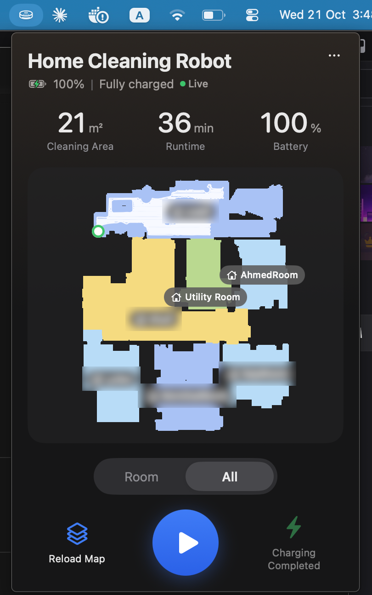

# DreameBar

Control a Dreame robot vacuum from the macOS menu bar.

<p align="center">
  
</p>

My robot vacuum has an iPhone app. My Mac doesn't. DreameBar is a small native menu bar app that talks to the same Dreamehome cloud the official app uses, so I can start a clean without picking up my phone.

## What it does

- **Live floor plan.** Your robot's real map, drawn the same way up as in the Dreamehome app, with room colours, room names (custom names in any language, including Arabic) and the dock.
- **Clean the whole house or just some rooms.** Switch between **All** and **Room**, tap rooms on the map to pick them, then press play.
- **Draw any shape to clean.** In **Zone** mode, trace around a spot on the map. The robot only accepts rectangles, so DreameBar fills your shape with up to 10 rectangles and shades exactly what will be cleaned.
- **Pause, resume and send it home** from the same panel.
- **Live updates.** While the robot cleans, its position and cleaning path update on the map in real time, along with status, battery, cleaned area and runtime.
- **Rename the robot** (double-click the name). The name is stored on your Mac only; see [Limitations](#limitations).
- **Light and dark mode**, following macOS.

## Requirements

- macOS 14 or later
- Xcode or the Swift 6 command line tools
- A Dreame robot vacuum set up in the **Dreamehome** app (not Xiaomi Home)
- A Dreamehome account with a password. If you signed up with Apple or Google, set a password in the Dreamehome app first; DreameBar can't use Apple or Google sign-in.

## Build and run

```bash
./build-app.sh
```

```bash
open DreameBar.app
```

A vacuum icon appears in the menu bar. Click it and sign in with your Dreamehome email (or phone number) and password. Leave **Server** on "Find automatically" unless you know your region.

## How it works

The robot doesn't accept commands on your home network. Everything goes through Dreame's cloud, so DreameBar does what the official app does:

1. **Signs in** to the Dreamehome cloud and keeps only the login token, in your macOS keychain. Your password is never saved.
2. **Sends commands** (start, pause, dock, clean rooms) as signed requests that the cloud relays to the robot.
3. **Downloads the map** the robot uploads, decrypts and decompresses it, and draws it. The live map has no room names; they live in a saved map embedded inside it, so DreameBar reads that one for the rooms and names.
4. **Listens to the live feed** over MQTT for status changes and map frames with the robot's position and path. Dreame's MQTT server uses its own self-signed certificate, so DreameBar pins that exact certificate instead of turning certificate checks off.

The code is a small Swift package with no dependencies:

| File | What's in it |
|---|---|
| `DreameCloud.swift` | Login, request signing, devices, commands, map downloads |
| `DreameMap.swift` | Map decryption, pixel formats, rooms, names, cleaning path |
| `DreameLive.swift` | Minimal receive-only MQTT client with certificate pinning |
| `VacuumStore.swift` | App state, polling and live updates |
| `DreameBarApp.swift`, `Theme.swift` | The menu bar UI |
| `ModelKeys.swift` | Per-model map decryption keys (generated) |

Diagnostics go to `~/Library/Logs/DreameBar.log`. It never contains tokens, passwords or map contents.

## Limitations

- **Unofficial.** This uses Dreame's private cloud API, which can change with any app update. Use it at your own risk.
- **Rename is local only.** No public project has worked out how the app renames a robot in the cloud, and the Dreamehome app rejects traffic inspection (certificate pinning). To change the name everywhere, rename it in the Dreamehome app.
- **Zone shapes are approximated with rectangles.** Rounded shapes follow your line closely; thin diagonal strips spill over a bit. The 10-rectangle limit is a cautious guess at what the robot accepts.
- Tested on one robot (`dreame.vacuum.r2423`). Room cleaning parameters differ slightly between models, so other models may need tweaks.

## Credits

The Dreamehome cloud protocol, map format and per-model map keys come from [Tasshack/dreame-vacuum](https://github.com/Tasshack/dreame-vacuum), the Home Assistant integration that did the hard reverse-engineering work. DreameBar ports the parts it needs to Swift. Both projects are MIT licensed; see [LICENSE](LICENSE).

Not affiliated with or endorsed by Dreame.
